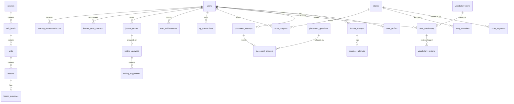

# Database Schema & Relational Design

The database is built on **PostgreSQL (Supabase)** with full **SQLite** local compatibility. All tables use normalized relational structures, strict foreign key constraints, cascading deletions where applicable, and indexed lookups for user learning analytics.

---

## Entity Relationship Overview

---

## Table Specifications

### 1. `users` & `user_profiles`
- `users`: `id`, `name`, `email`, `role` (`learner`, `admin`), `password`, `created_at`.
- `user_profiles`: `user_id`, `learning_reason`, `daily_goal_minutes`, `experience_level`, `explanation_dialect`, `target_variant`, `estimated_cefr_level`, `onboarding_completed`, `total_xp`, `current_streak`, `longest_streak`, `last_activity_date`, `timezone`.

### 2. Curriculum (`courses`, `cefr_levels`, `units`, `lessons`, `lesson_exercises`)
- `courses`: `slug`, `title`, `title_ar`, `target_language` (`es-ES`), `source_language` (`ar-EG`), `is_published`.
- `cefr_levels`: `course_id`, `code` (`A1`...`C2`), `name`, `name_ar`, `order_index`.
- `units`: `cefr_level_id`, `title`, `title_ar`, `icon`, `order_index`.
- `lessons`: `unit_id`, `title`, `title_ar`, `objective_ar`, `grammar_notes_ar`, `estimated_minutes`, `xp_reward`, `order_index`.
- `lesson_exercises`: `lesson_id`, `exercise_type` (`multiple_choice`, `translation`, `fill_blank`, `word_order`, `matching_pairs`), `prompt`, `prompt_ar`, `options` (JSON), `correct_answers` (JSON), `explanation_ar`, `hint_ar`, `xp_value`.

### 3. Lesson Sessions & Attempts
- `lesson_attempts`: `user_id`, `lesson_id`, `status` (`in_progress`, `completed`), `score_percent`, `xp_awarded`, `is_reward_claimed`, `started_at`, `completed_at`.
- `exercise_attempts`: `lesson_attempt_id`, `user_id`, `lesson_exercise_id`, `user_answer`, `is_correct`, `attempt_number`.

### 4. Placement Testing Engine
- `placement_questions`: `skill_category` (`vocabulary`, `grammar`, `reading`), `difficulty_level`, `question_type`, `question_text`, `context_text`, `prompt_ar`, `options` (JSON), `correct_answer`, `explanation_ar`, `points`.
- `placement_attempts`: `user_id`, `status`, `total_score`, `estimated_level`, `skill_breakdown` (JSON), `summary_report_ar`, `recommended_unit_id`, `started_at`, `completed_at`.
- `placement_answers`: `placement_attempt_id`, `placement_question_id`, `user_answer`, `is_correct`, `points_awarded`, `time_spent_seconds`.

### 5. Vocabulary & Spaced Repetition (SM-2)
- `vocabulary_items`: `spanish_word`, `phonetic`, `part_of_speech`, `arabic_meaning`, `example_sentence_es`, `example_sentence_ar`, `cefr_level`, `topic`.
- `user_vocabulary`: `user_id`, `vocabulary_item_id`, `mastery_level`, `repetitions`, `interval_days`, `ease_factor` (decimal default 2.50), `next_review_at`, `last_reviewed_at`.
- `vocabulary_reviews`: `user_id`, `user_vocabulary_id`, `quality_rating` (0-5), `repetition_number`, `interval_applied`.

### 6. Interactive Stories
- `stories`: `cefr_level`, `title_es`, `title_ar`, `summary_ar`, `topic`, `estimated_minutes`, `xp_reward`.
- `story_segments`: `story_id`, `order_index`, `speaker_name`, `spanish_text`, `arabic_translation`, `explanation_ar`, `vocabulary_highlights` (JSON).
- `story_questions`: `story_id`, `after_segment_index`, `question_es`, `question_ar`, `options` (JSON), `correct_answer`, `explanation_ar`.
- `story_progress`: `user_id`, `story_id`, `current_segment_index`, `is_completed`, `is_reward_claimed`.

### 7. Gamification & System Logs
- `xp_transactions`: `user_id`, `amount`, `source_type`, `source_id`, `idempotency_key` (UNIQUE), `description`.
- `achievements`: `code` (UNIQUE), `title_ar`, `description_ar`, `icon`, `xp_reward`.
- `user_achievements`: `user_id`, `achievement_id`, `unlocked_at`.
- `ai_tutor_logs`: `user_id`, `action_type`, `prompt_summary`, `response_summary`, `model_used`, `tokens_used`.

### 8. Spanish Journal & Learner Error Profile
- `journal_entries`: `user_id`, `title`, `content` (original text strictly preserved), `prompt_topic`, `word_count`, `cefr_level_target`, `is_draft`, `is_analyzed`, `created_at`, `updated_at`.
- `writing_analyses`: `journal_entry_id`, `overall_feedback_ar`, `corrected_content`, `grammar_score`, `vocabulary_score`, `naturalness_score`, `analyzed_at`.
- `writing_suggestions`: `writing_analysis_id`, `concept_key` (e.g., `ser-vs-estar`, `por-vs-para`), `error_type`, `severity` (`info`, `warning`, `error`), `original_snippet`, `replacement_snippet`, `explanation_ar`.
- `learner_error_concepts`: `user_id`, `concept_key`, `category`, `title_ar`, `explanation_ar`, `occurrences_count`, `mastery_score` (0-100), `last_seen_at`.
- `learning_recommendations`: `user_id`, `concept_key`, `reason_ar`, `action_type`, `target_id`, `is_completed`, `created_at`.
